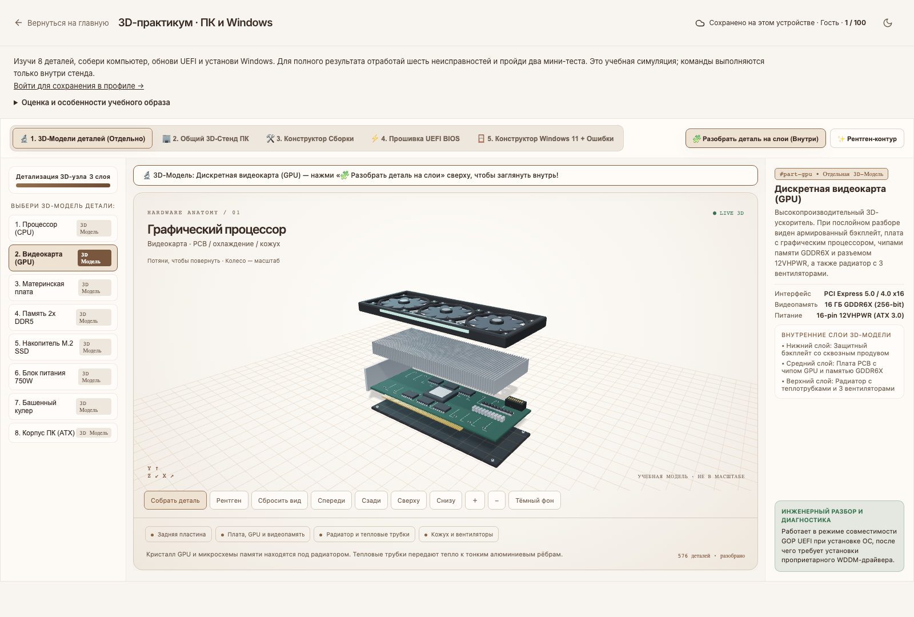
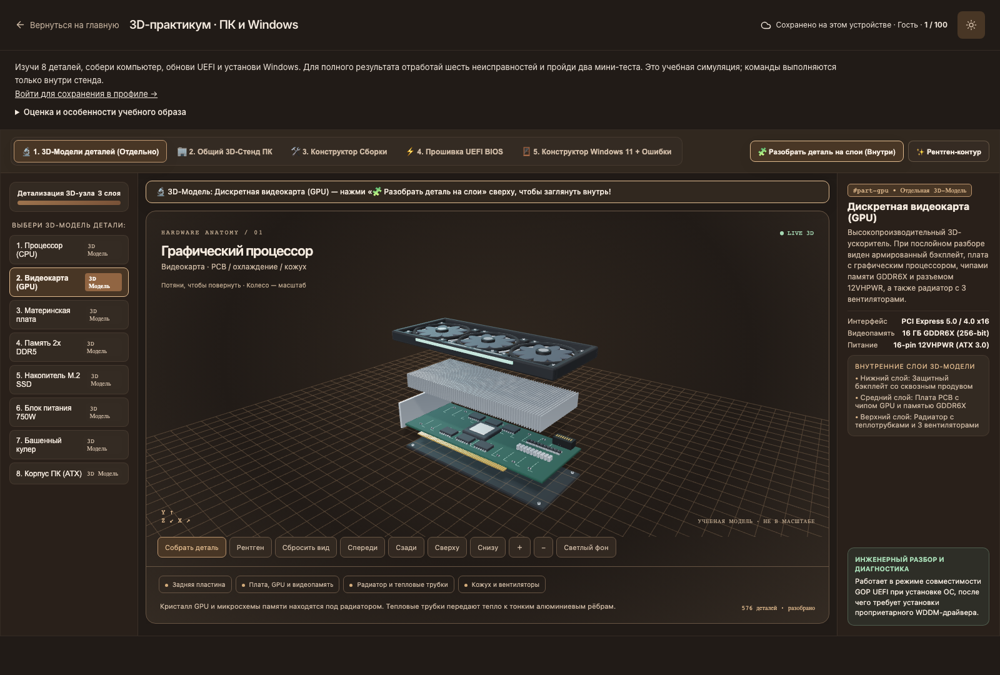
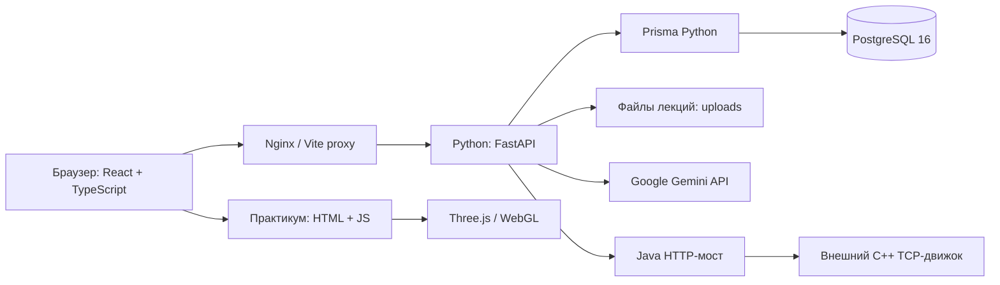

# Aituto — учебная платформа с ИИ и 3D-практикумом

**Aituto / AI Tutor** объединяет учебные материалы, персональные тесты, помощь ИИ, инструменты преподавателя и интерактивную лабораторию по устройству компьютера. Проект предназначен для самостоятельного обучения и сопровождения занятий: студент изучает материал, выполняет задания, получает обратную связь и возвращается к темам, которые требуют повторения.

**Сайт:** [sizizxc.me](https://sizizxc.me/) · **Практикум:** [ПК и Windows](https://sizizxc.me/pc-lab) · **Основа для диплома:** [diplom.md](diplom.md)

Основной сервер приложения написан на **Python/FastAPI**. Название локального каталога `AItutorJavaServer` сохранилось исторически: Java используется в отдельном мосте поиска кабинетов. Node.js нужен для сборки интерфейса и инструментов Prisma; прежний Node/Fastify backend удалён.

Документ описывает реализацию репозитория на 15 октября 2026 года. Наличие функции в коде не означает, что её внешние сервисы доступны без настройки.

## Содержание

1. [Возможности и роли](#возможности-и-роли)
2. [3D-практикум ПК и Windows](#3d-практикум-пк-и-windows)
3. [Архитектура и стек](#архитектура-и-стек)
4. [Структура репозитория](#структура-репозитория)
5. [Данные и основные процессы](#данные-и-основные-процессы)
6. [Запуск через Docker](#запуск-через-docker)
7. [Логины, пароли и Prisma Studio](#логины-пароли-и-prisma-studio)
8. [Локальная разработка](#локальная-разработка)
9. [Настройки окружения](#настройки-окружения)
10. [API и интеграции](#api-и-интеграции)
11. [Проверки качества](#проверки-качества)
12. [Развёртывание и эксплуатация](#развёртывание-и-эксплуатация)
13. [Диагностика и ограничения](#диагностика-и-ограничения)
14. [Материалы для диплома](#материалы-для-диплома)

## Возможности и роли

| Пользователь | Основные действия |
|---|---|
| Гость | Просмотр главной, регистрация, полный практикум ПК с локальным сохранением |
| `STUDENT` | Предметы, доступные лекции, тесты, ИИ-помощник, повторение, расписание, сообщения, личные инструменты |
| `TEACHER` | Создание предметов и лекций, работа со своими группами и студентами, учебная аналитика |
| `ADMIN` | Управление пользователями и ролями, группами, предметами, темами и расписанием |

Обычная регистрация создаёт студента. Получить роль преподавателя или администратора через публичную форму нельзя: такие права назначает администратор. Сервер проверяет актуальную роль и активность пользователя в базе, а затем право доступа к конкретной записи. Одного скрытия кнопки в интерфейсе для контроля доступа недостаточно.

Студент может генерировать тесты по предмету, теме, сложности и типам вопросов. Результат содержит оценку, правильные и неправильные ответы, объяснения и доступный ИИ-анализ. История попыток, тематический прогресс, опыт и достижения помогают видеть динамику обучения. Раздел повторения показывает темы с наступившей датой следующего занятия.

В AI Tutor доступны обычный диалог, помощь с домашним заданием, изучение темы и объяснение термина. School Companion добавляет карточки, викторины, заметки и план задач. Режим Фейнмана предлагает объяснить материал своими словами; дебаты тренируют аргументацию. Это отдельные сценарии общения с моделью, а не собственная обученная нейросеть проекта.

Преподаватель прикрепляет материал к лекции и использует его для объяснения, извлечения текста или генерации теста. Поддерживаются PDF, DOCX, PPTX, UTF-8 TXT/MD/CSV и изображения JPEG/PNG/WebP. PDF и изображения обрабатываются через Gemini, из офисных документов извлекается текст. Старый бинарный PPT нужно преобразовать в PPTX или PDF. Иллюстрации презентации лучше передавать в PDF, если они важны для объяснения.

## 3D-практикум ПК и Windows



Практикум доступен по `/pc-lab` и содержит пять связанных модулей:

1. **Отдельные компоненты.** Процессор, видеокарта, материнская плата, оперативная память, NVMe M.2, блок питания, башенный кулер и корпус. Модель можно вращать, приближать, рассматривать с разных сторон, разделять на узлы и делать прозрачной.
2. **Общий компьютер.** Нажатие на компонент в корпусе или списке извлекает его и открывает отдельный осмотр. Есть возврат детали и разнесение всех компонентов.
3. **Сборка.** Нужно выбрать подходящий слот и соблюдать зависимости установки. Неверное действие объясняется и учитывается. Доступны подсказки, автошаг и новая попытка.
4. **UEFI BIOS.** Учебная последовательность POST, входа через DEL, выбора файла M-Flash и обновления прошивки.
5. **Windows.** Выбор редакции, языка, региона, клавиатуры, разделов диска и драйверов, устранение неисправностей и выход на учебный рабочий стол.

Установщик включает шесть ситуаций: TPM/Secure Boot, скрытый диск Intel VMD, конфликт MBR/GPT, сетевой этап OOBE, недостаточное место на системном разделе и повторную загрузку с USB. Два мини-теста проверяют резервное копирование, UEFI/GPT, назначение EFI и подбор драйверов. Неверный ответ сопровождается объяснением; продолжение открывается после исправления.

Баллы вычисляются сервером: до 15 за изучение деталей, до 30 за сборку с вычетом двух баллов за ошибку и минимумом 15 при завершении, 20 за BIOS и 35 за Windows. Для последних 35 баллов программа v2 требует решить все шесть неисправностей и правильно ответить на четыре вопроса. Порог зачёта — 80. Отключение неисправности не засчитывается как её решение.

Гостевой прогресс хранится в браузере; авторизованный пользователь получает сохранение в PostgreSQL и результат в профиле. Черновики разных пользователей разделены. При конфликте ревизий сервер возвращает 409, а интерфейс предлагает загрузить серверную версию. Ошибка сети не удаляет локальную работу.

Цвета практикума совпадают с сайтом: кремовые поверхности, коричневые акценты, тёплая тёмная тема. Общий переключатель меняет оформление без перезапуска упражнения; отдельная кнопка в сцене меняет её фон. Three.js строит настоящую объёмную геометрию. Если WebGL недоступен, остаётся интерактивный SVG-режим. Модели учебные и не гарантируют размеры конкретного изделия.

<details>
<summary>Посмотреть тёмную тему</summary>



</details>

## Архитектура и стек



| Слой | Реализация в проекте |
|---|---|
| Интерфейс | React 19, TypeScript, Vite 6, React Router 7 |
| Состояние и запросы | Zustand, Axios, отмена запросов при смене экранов |
| Оформление | Tailwind CSS 4, общие CSS-переменные, Framer Motion, Lucide |
| 3D | Three.js, OrbitControls, процедурная геометрия, отдельная точка входа Vite |
| HTTP API | FastAPI, Pydantic, uvicorn, Python 3.12 в Docker |
| Хранение | PostgreSQL 16, Prisma Python, локальный каталог вложений |
| ИИ | Общий асинхронный REST-клиент Gemini на httpx |
| Инфраструктура | Docker Compose, Nginx, виртуальная машина Azure |
| Дополнительная интеграция | Java 17 / Spring Boot, TCP-протокол внешнего поиска кабинетов |

Точные зависимости находятся в `frontend/package-lock.json` и `python_backend/requirements.txt`. Обозначение «микросервисы» применимо прежде всего к интеграциям: основной Python backend является модульным приложением с общими слоями маршрутов, схем и сервисов.

## Структура репозитория

```text
.
├── frontend/
│   ├── src/
│   │   ├── api/                 # HTTP-клиент и контракты запросов
│   │   ├── store/               # Авторизация и тема
│   │   ├── layouts/             # Оболочки приложения и входа
│   │   ├── pages/               # Студент, преподаватель, администратор
│   │   ├── features/pc-lab/     # Сохранение практикума, модели, сцена
│   │   └── styles/              # Общие стили сайта
│   ├── public/pc-lab-assets/    # Стенд, сценарии, общая палитра
│   └── pc-lab-viewer.html       # Вторая точка входа Vite
├── python_backend/
│   ├── app/routers/            # API-маршруты
│   ├── app/schemas/            # Pydantic-валидация
│   ├── app/services/           # Предметная логика и интеграции
│   ├── app/core/               # Настройки, безопасность, ошибки
│   ├── app/db/                 # Подключение Prisma
│   ├── tests/                  # Автоматические проверки
│   ├── migrations/             # Дополнительные SQL-изменения
│   ├── scripts/seed.py         # Каталог достижений и демоданные
│   ├── schema.prisma           # Модели PostgreSQL
│   └── uploads/                # Загруженные файлы, исключены из Git
├── room-finder-java/           # HTTP → TCP и работа с расписанием
├── mock-cpp-room-server/       # Локальная заглушка TCP-движка
├── mock-schedule-server/       # Вспомогательная заглушка расписания
├── camera-service/            # Отдельный C++ каркас, не подключён к сайту
├── scripts/                   # Запуск интеграции и браузерные проверки
├── nginx/                     # Внешний reverse proxy
├── docs/                      # Архитектура, аудиты, практикум, изображения
├── design-system/             # Описание визуальной системы
├── docker-compose.yml         # Разработка
├── docker-compose.prod.yml    # Production
├── .env.example               # Пример настроек без рабочих ключей
└── diplom.md                  # Фактическая основа и план диплома
```

## Данные и основные процессы

В Prisma описана 21 модель. `User`, `RefreshToken`, `StudentProfile` и `Group` отвечают за пользователей и группы; `Subject`, `Topic`, `Lecture` — за содержание. `Test`, `TestQuestion`, `Attempt`, `Answer` описывают тестирование. `TopicProgress`, `StudySession`, `Achievement`, `UserAchievement` — прогресс и мотивацию. Остальные модели включают расписание, сообщения, журнал действий, ИИ-взаимодействия и `PcLabProgress`.

Companion хранит заметки, задачи, карточки и викторины в JSON внутри существующего `AIInteraction`, различая записи по типам `COMPANION_*`. Это упрощает текущую схему, но усложняет будущую отчётность и массовый поиск. Списки ограничены последними 100 записями.

При генерации теста сервер собирает сведения о слабых темах, недавних ошибках и завершённых попытках, формирует запрос к Gemini и проверяет структурированный результат. Pydantic проверяет форму, количество и типы вопросов; содержательную правильность всё равно следует оценивать преподавателю. Подстройка основана на сохранённой статистике, а не на обучении собственной модели.

При отправке ответов сервер проверяет принадлежность попытки и вычисляет результат. Для вариантов выбора регистр и пунктуация значимы; порядок нескольких выбранных вариантов не влияет на оценку. Повторное завершение защищено от повторного начисления результатов. Прогресс темы отражает долю правильных ответов; интервал повторения изменяется по простой эвристике.

## Запуск через Docker

Нужны Git, Docker и Docker Compose 2.24+. Команды ниже рассчитаны на **новую локальную установку**. На существующей базе нельзя автоматически повторять инициализацию или удалять том ради устранения ошибки.

```bash
git clone https://github.com/hatause/diplom.git
cd diplom
cp .env.example .env
```

Заполните `JWT_SECRET` и `REFRESH_TOKEN_SECRET` разными случайными значениями, а `GEMINI_API_KEY` — своим ключом. Секрет можно получить командой `openssl rand -hex 32`. Копирование примера допустимо только при первой настройке: существующий `.env` сохраняют.

```bash
docker compose build
docker compose up -d postgres
docker compose run --rm backend prisma db push --schema schema.prisma --skip-generate
docker compose run --rm backend python scripts/seed.py --demo
docker compose up -d
docker compose ps
```

| Сервис | Локальный адрес |
|---|---|
| Сайт | `http://localhost:5173` |
| Практикум | `http://localhost:5173/pc-lab` |
| API | `http://localhost:4000/api/v1` |
| OpenAPI / Swagger | `http://localhost:4000/docs` |
| Проверка сервера и БД | `http://localhost:4000/health` |
| PostgreSQL с хоста | `localhost:5433` |

Запуск приложения не меняет схему и не создаёт пользователей автоматически. Без `--demo` seed заполняет только каталог достижений. Остановка: `docker compose stop`; для просмотра ошибок: `docker compose logs --tail=100 backend frontend`.

## Логины, пароли и Prisma Studio

Следующие аккаунты создаются **только явной командой `seed.py --demo`**. Это данные локального учебного стенда, уже определённые в исходном seed; они не являются подтверждёнными паролями опубликованного сайта.

| Роль | Email / логин | Пароль нового демо-аккаунта |
|---|---|---|
| Администратор | `admin@aitutor.com` | `password123` |
| Преподаватель | `petrov@aitutor.com` | `password123` |
| Преподаватель | `sidorova@aitutor.com` | `password123` |
| Студент | `student@aitutor.com` | `password123` |
| Студент | `maria@aitutor.com` | `password123` |

Повторный seed **не сбрасывает существующие пароли**. Если вход не проходит, проверьте выбранную базу, наличие аккаунта и изменение его пароля. Демо-учётные записи с общим паролем не предназначены для публичной эксплуатации. Рабочие секреты и SSH-ключи не публикуются в репозитории.

Для локального PostgreSQL стандартный Compose использует пользователя `aitutor`, пароль `aitutor_secret`, базу `aitutor`, внешний порт `5433`. Внутри Docker адрес — `postgres:5432`. Это отдельные реквизиты БД, не логин администратора сайта.

После установки Python-зависимостей Studio можно открыть из корня:

```bash
.venv/bin/prisma studio --schema python_backend/schema.prisma --hostname 127.0.0.1 --port 5555
```

Откройте `http://localhost:5555`; соединение берётся из `DATABASE_URL`. Studio предоставляет доступ к данным БД, поэтому используйте его локально, не открывайте порт в Azure. В таблице пользователей находятся хеши паролей bcrypt: получить исходный пароль из них нельзя.

## Локальная разработка

Можно запустить PostgreSQL в Docker, а API и Vite — отдельными процессами. Для API используйте Python 3.12. Docker-образ frontend собирается на Node.js 20; локальная проверка выполнена на Node.js 22. Не запускайте одновременно контейнерный и локальный API на одном порту.

```bash
docker compose up -d postgres
python3 -m venv .venv
.venv/bin/pip install -r python_backend/requirements.txt
.venv/bin/prisma generate --schema python_backend/schema.prisma
.venv/bin/python -m uvicorn app.main:app --app-dir python_backend --host 127.0.0.1 --port 4000
```

В другом терминале:

```bash
npm ci --prefix frontend
npm run dev --prefix frontend
```

Для новой БД перед запуском выполните создание схемы и seed, как описано в [руководстве backend](python_backend/README.md). Vite проксирует `/api` на `127.0.0.1:4000`; адрес меняется через `BACKEND_URL`. Загрузки находятся в `python_backend/uploads` независимо от рабочей директории процесса.

## Настройки окружения

| Переменная | Назначение |
|---|---|
| `DATABASE_URL` | Соединение Prisma с PostgreSQL |
| `JWT_SECRET`, `REFRESH_TOKEN_SECRET` | Подпись access и refresh токенов |
| `NODE_ENV` | В production включает Secure для refresh-cookie |
| `CORS_ORIGIN` | Разрешённые адреса интерфейса через запятую |
| `SCHOOL_TIMEZONE` | Часовой пояс учебной статистики, обычно `Asia/Almaty` |
| `GEMINI_API_KEY`, `GEMINI_MODEL` | Ключ провайдера и модель; значение по умолчанию в коде — `gemini-2.5-flash` |
| `AI_TIMEOUT_SECONDS` | Общий предел ожидания ИИ, по умолчанию 90 секунд |
| `ROOM_FINDER_JAVA_URL` | Адрес Java-моста для локального API |
| `ROOM_FINDER_JAVA_URL_DOCKER` | Адрес моста из контейнера |
| `POSTGRES_USER/PASSWORD/DB` | Параметры production PostgreSQL при первоначальной настройке |
| `VITE_API_URL` | Базовый путь браузерного API, обычно `/api/v1` |

Docker читает корневой `.env` и необязательный `python_backend/.env`; адрес контейнерной БД задаётся Compose. Проверяйте оба файла при расхождении настроек. Переменные `VITE_*` попадают в клиентскую сборку, поэтому ключ Gemini туда помещать нельзя.

## API и интеграции

Основные группы `/api/v1`: `auth`, `subjects`, `tests`, `attempts`, `lectures`, `ai`, `companion`, `analytics`, `review`, `achievements`, `schedule`, `messages`, `groups`, `teacher`, `admin`, `feynman`, `debate`, `classroom`, `pc-lab`. Точные методы и схемы запросов доступны в OpenAPI работающего сервера.

Авторизация использует короткий access JWT и refresh-cookie с `HttpOnly`. API-клиент добавляет Bearer-токен и объединяет параллельные обновления сессии. Вложения выдаются через защищённый маршрут после проверки доступа к лекции. Файл ограничен 12 МБ, извлечённый текст — 120 000 символов.

Поиск кабинета проходит цепочку Python → Java `/api/bridge` → C++ TCP. При локальном запуске `./scripts/start-room-finder.sh` может использовать заглушку C++; её ответ не подтверждает реальную занятость помещений. Java требует JDK 17+ и Maven. Обычное расписание сайта Python читает из PostgreSQL. Каталог `camera-service` существует отдельно и не подключён к рабочему сценарию сайта.

## Проверки качества

```bash
npm run lint --prefix frontend
npm run build --prefix frontend
PYTHONPATH=python_backend .venv/bin/python -m unittest discover -s python_backend/tests -v
mvn -f room-finder-java/pom.xml test
```

Для проверок БД создайте отдельную тестовую PostgreSQL, примените схему и задайте её `DATABASE_URL`, затем добавьте `RUN_DB_TESTS=1`. Не запускайте интеграционные сценарии на production: они создают тестовые записи.

Браузерные сценарии находятся в `scripts/check-pc-lab.cjs` и `scripts/check-pc-hardware.cjs`. Они требуют Playwright и установленного Chromium; путь к модулю можно передать через `PLAYWRIGHT_MODULE`, адрес Vite — через `LAB_TEST_URL`. Первый сценарий требует отдельной тестовой БД, второй проверяет публичную 3D-часть без аккаунта.

Зафиксированный проход обновления 3D: 69 Python-тестов, 38 проверок практикума и 61 проверка аппаратной сцены. Предыдущий аудит также содержит 9 Java-тестов. Проверка общей палитры дополнительно охватила вложенные документы, сохранение состояния, обе темы и ширину 390/320 px. Это результаты конкретных запусков, не процент покрытия и не доказательство отсутствия любых ошибок. ИИ в автотестах заменён управляемыми ответами.

## Развёртывание и эксплуатация

Production работает на Azure VM через `docker-compose.prod.yml`: PostgreSQL, Python backend, статический frontend и внешний Nginx. Настройка HTTPS и сертификатов относится к серверной конфигурации; сам проброс порта 443 ещё не создаёт TLS.

Перед обновлением сохраните PostgreSQL, uploads, `.env` и конфигурацию Nginx; запишите текущий commit и образ. Проверьте локальные изменения на сервере, затем используйте `git pull --ff-only`. Для обновления только интерфейса:

```bash
docker compose -f docker-compose.prod.yml build frontend
docker compose -f docker-compose.prod.yml up -d --no-deps frontend
docker compose -f docker-compose.prod.yml ps
docker exec aitutor-nginx nginx -t
docker exec aitutor-nginx nginx -s reload
```

При изменении backend пересоберите соответствующий сервис и отдельно проверьте необходимость миграций. Обновление цвета не требует изменения БД. Для первоначального добавления практикума предусмотрен SQL `python_backend/migrations/20261015_pc_lab_progress.sql`. Инструкция и порядок отката находятся в [описании практикума](docs/pc-lab.md).

Не удаляйте том `postgres-data` при обычном обновлении. Архив uploads храните вместе с резервной копией БД: ссылки на лекции без файлов недостаточны для восстановления. После выкладки проверьте `/health`, вход, открытие лекции, практикум и сетевые ошибки браузера.

## Диагностика и ограничения

| Симптом | Что проверить |
|---|---|
| 500 при регистрации | Запущен ли API, верна ли БД, существует ли схема; повторный email должен давать 409 |
| Предмет не создаётся | Роль, уникальность кода, допустимый преподаватель, сообщение API |
| Лекция не объясняется | Доступность вложения, формат, размер, ключ/квота Gemini, таймаут |
| Область 3D пустая | WebGL, аппаратное ускорение, загрузка `pc-lab-viewer.html`; вне экрана рендер приостанавливается |
| Прогресс не отправляется | Сессия, сеть, конфликт ревизий; сначала сохраните локальный черновик |
| Кабинет не найден | Отличайте штатное отсутствие результата от 503/504 интеграции |
| После обновления старые цвета | Новая сборка, ответы статических ресурсов, обновление страницы |

Краткий ответ в викторине проверяется нормализацией текста, а не полноценным семантическим анализом. Ограничения запросов ИИ действуют на процесс. Практикум доверяет событиям браузера и предназначен для тренировки, а не защищённого экзамена. Реальные камеры и внешний C++-движок требуют отдельной проверки. Педагогическая эффективность не подтверждена экспериментом; проект предоставляет инструменты для её будущего измерения.

## Материалы для диплома

[diplom.md](diplom.md) содержит предлагаемые тему, цель, задачи, подробное содержание, описание модулей, модели данных, алгоритмы, проверяемые результаты и инструкции для ИИ-помощника. Дополнительные источники: [архитектура](docs/current-architecture.md), [практикум](docs/pc-lab.md), [аудит 13 октября](docs/site-audit-2026-10-13.md), [аудит 15 октября](docs/site-audit-2026-10-15.md), [backend](python_backend/README.md).
