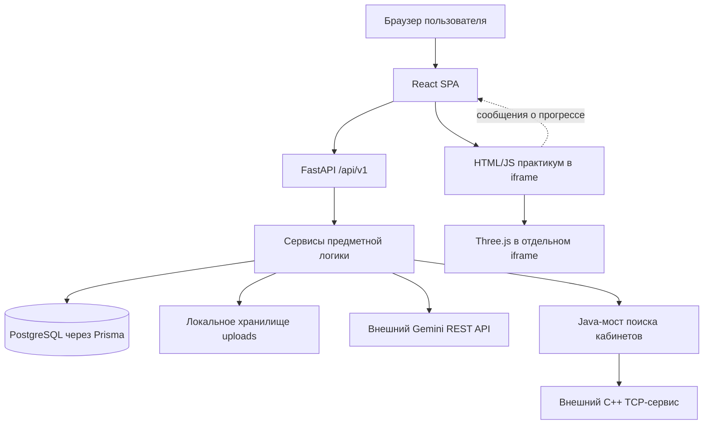
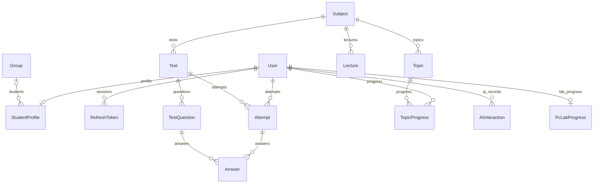
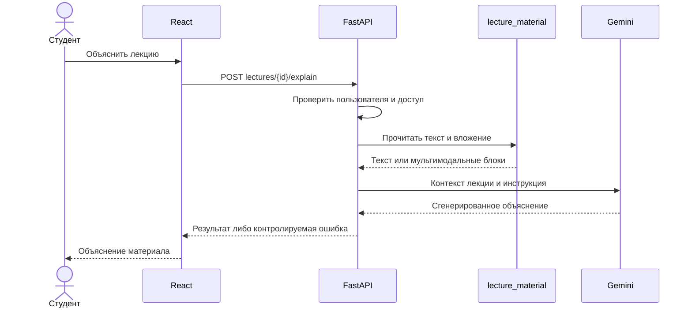

# Основа дипломной работы по проекту Aituto / AI Tutor

> Техническое задание и фактический контекст для подготовки диплома. Документ предназначен автору, научному руководителю и ИИ-помощнику, которому нужно понять проект без истории переписки. Это план и описание реализованной системы, а не готовая дипломная работа и не отчёт о педагогическом эксперименте.

**Срез реализации:** 15 октября 2026 года.

**Репозиторий:** [github.com/hatause/diplom](https://github.com/hatause/diplom).

**Сайт:** [sizizxc.me](https://sizizxc.me/).

**Практикум:** [sizizxc.me/pc-lab](https://sizizxc.me/pc-lab).

**Инструкция запуска и демо-доступ:** [README.md](README.md).

## 1. Что представляет собой проект

Aituto — веб-платформа сопровождения учебного процесса с тремя авторизованными ролями: студент, преподаватель и администратор. Она объединяет каталог предметов и лекций, генерацию и прохождение тестов, историю результатов, аналитику, повторение, ИИ-помощника, инструменты самостоятельной работы, расписание и сообщения. Отдельный модуль позволяет изучать детали компьютера, собирать ПК, проходить учебное обновление BIOS и установку Windows с неисправностями.

Главная идея — связать изучение материала, практическое действие и обратную связь в одном интерфейсе. Например, студент читает лекцию, просит объяснить вложенную презентацию, проходит сформированный по материалу тест и возвращается к слабым темам. В аппаратной лаборатории он выполняет действия в симуляции и получает результат, сохраняемый в профиле.

Основной HTTP backend написан на Python с FastAPI. Frontend — React и TypeScript. Данные хранятся в PostgreSQL, доступ организован через Prisma Python. Генеративные функции вызывают внешний Google Gemini API. Трёхмерные модели создаются программно средствами Three.js и отображаются через WebGL. Docker Compose и Nginx используются для развёртывания на виртуальной машине Azure.

Java не является основным сервером учебной платформы. Каталог `room-finder-java` реализует отдельный HTTP-мост к внешнему TCP-движку поиска кабинетов. `camera-service` — самостоятельный C++ каркас, который не подключён к рабочему веб-сценарию. Эти границы принципиальны для корректного описания диплома.

## 2. Предлагаемая тема, цель и задачи

### 2.1. Тема

Основной вариант: **«Разработка веб-платформы интеллектуальной поддержки обучения с персонализированным тестированием и интерактивным 3D-практикумом»**.

Более узкий вариант, если кафедра требует акцент на практической подготовке: **«Разработка образовательной веб-платформы с ИИ-помощником и тренажёром сборки персонального компьютера и установки операционной системы»**.

Окончательное название должен утвердить руководитель. Не следует включать в тему компьютерное зрение, собственную нейронную сеть или автоматическое управление камерами: это не описывает реализованное ядро сайта.

### 2.2. Актуальность и проблема

Учебные материалы, проверка знаний и практические тренажёры часто существуют раздельно. Студенту приходится переключаться между инструментами; преподавателю — вручную подготавливать задания и анализировать результаты. Для аппаратных занятий дополнительно нужны доступные компьютеры и возможность повторять действия без риска повредить учебное оборудование.

Проект исследует возможность объединения этих процессов в веб-системе. Генеративная модель помогает создавать объяснения и задания, а интерактивная лаборатория даёт повторяемый учебный сценарий. Эти положения являются обоснованием разработки. Утверждения о распространённости проблемы и эффективности подхода в дипломе должны подкрепляться литературой и собственными измерениями, а не выводиться только из наличия приложения.

### 2.3. Объект, предмет, цель

- **Объект исследования:** процесс цифровой поддержки самостоятельного и организованного обучения.
- **Предмет исследования:** программные методы интеграции учебных материалов, генеративного ИИ, оценки результатов и интерактивного аппаратного практикума.
- **Цель:** разработать и проверить веб-платформу, объединяющую работу с материалами, персонализированное тестирование и практические учебные сценарии с сохранением прогресса.
- **Практическая значимость:** единое место для материалов и результатов, повторяемая тренировка сборки ПК, возможность объяснения прикреплённых документов и подготовки заданий преподавателем.

### 2.4. Задачи

1. Проанализировать роли пользователей, учебные сценарии и ограничения предметной области.
2. Сформировать функциональные и нефункциональные требования.
3. Спроектировать клиент-серверную архитектуру и реляционную модель данных.
4. Реализовать авторизацию, разграничение доступа и управление учебным содержанием.
5. Интегрировать внешний ИИ с проверкой структуры ответов и обработкой отказов.
6. Реализовать генерацию тестов с учётом истории ошибок, оценивание и повторение тем.
7. Создать браузерные 3D-модели и интерактивные сценарии сборки, BIOS и Windows.
8. Обеспечить локальное и серверное сохранение прогресса и обработку конфликтов.
9. Провести функциональные, интеграционные и интерфейсные проверки.
10. Развернуть приложение, описать эксплуатацию, ограничения и перспективы развития.

Методы: анализ требований, моделирование вариантов использования, проектирование реляционных данных, модульная разработка, интеграция HTTP/TCP, процедурное 3D-моделирование, автоматизированное тестирование и визуальная проверка. Научную новизну нельзя объявлять без сравнения с существующими решениями; здесь надёжнее говорить об инженерном результате и интеграции функций.

## 3. Предлагаемое подробное содержание диплома

Объём и обязательные главы уточняются по методическим требованиям кафедры. Пример распределения — ориентир, а не утверждённый стандарт.

### Введение — ориентировочно 3–5 страниц

Актуальность, проблема, объект и предмет, цель и задачи, методы, практическая значимость. Кратко обозначить продукт и основные результаты. Не включать сюда длинные списки библиотек или подробные инструкции установки.

### Глава 1. Анализ предметной области и постановка задачи — 10–14 страниц

- **1.1.** Организация самостоятельного обучения и контроля знаний.
- **1.2.** Роли студента, преподавателя и администратора.
- **1.3.** Возможности и ограничения генеративного ИИ в образовании.
- **1.4.** Персонализация заданий на основе истории результатов.
- **1.5.** Виртуальные лаборатории и трёхмерная визуализация аппаратных компонентов.
- **1.6.** Сравнение существующих решений по проверяемым критериям.
- **1.7.** Требования к разрабатываемой системе.
- **1.8.** Выводы и постановка задачи разработки.

Для сравнения аналогов подобрать реальные продукты и источники: наличие ролей, материалов, тестов, аналитики, ИИ, 3D-лаборатории, сохранения и развёртывания. Не заполнять таблицу произвольными оценками «лучше/хуже». Функции и условия продуктов нужно проверять на дату написания.

### Глава 2. Проектирование платформы — 12–16 страниц

- **2.1.** Общая архитектура и границы модулей.
- **2.2.** Выбор стека с учётом задач проекта.
- **2.3.** Модель ролей и сценариев использования.
- **2.4.** Проектирование базы данных и связей сущностей.
- **2.5.** Контракты HTTP API и обработка ошибок.
- **2.6.** Работа с учебными файлами и контекстом ИИ.
- **2.7.** Алгоритмы тестирования, оценки и повторения.
- **2.8.** Модель состояния 3D-практикума.
- **2.9.** Сохранение прогресса и конкурентные изменения.
- **2.10.** Проектирование интерфейса, тем и доступности.
- **2.11.** Выводы по проектированию.

Здесь уместны схема компонентов, ER-диаграмма, диаграммы последовательности и таблица требований. Следует объяснять решения и их ограничения: почему некоторые Companion-данные хранятся в JSON, почему практикум отделён iframe, какие задачи решает серверная проверка прав.

### Глава 3. Реализация программной системы — 16–22 страницы

- **3.1.** Организация репозитория и конфигурации.
- **3.2.** Клиентское приложение React и маршрутизация.
- **3.3.** FastAPI, схемы Pydantic и слой сервисов.
- **3.4.** Регистрация, вход, обновление сессии и роли.
- **3.5.** Предметы, группы, лекции и вложения.
- **3.6.** Интеграция Gemini: контекст, формат ответа, ограничения.
- **3.7.** Генерация и прохождение тестов, результаты, аналитика.
- **3.8.** Companion, Фейнман и дебаты.
- **3.9.** Геометрия деталей компьютера и управление 3D-сценой.
- **3.10.** Сборка ПК и диагностика ошибочных действий.
- **3.11.** Симуляция BIOS и установка Windows с мини-тестами.
- **3.12.** Сохранение, восстановление и расчёт результата практикума.
- **3.13.** Интеграция поиска кабинета.
- **3.14.** Развёртывание в Docker и Azure.
- **3.15.** Выводы по реализации.

Листинги выбирать короткие и содержательные: проверка доступа, сбор учебного контекста, оценка ответа, вычисление баллов практикума, конфликт ревизий. Не переносить в основной текст сотни строк моделей или полный seed.

### Глава 4. Проверка и оценка результата — 10–14 страниц

- **4.1.** Тестовая среда и разделение локальной и рабочей БД.
- **4.2.** План тестирования по требованиям.
- **4.3.** Проверки ролей, регистрации, предметов и лекций.
- **4.4.** Проверки тестирования, ИИ-ответов и ошибок провайдера.
- **4.5.** Проверки практикума: геометрия, события, состояние, оценка.
- **4.6.** Проверки адаптивности, тем, клавиатуры и резервного режима.
- **4.7.** Исправленные дефекты и регрессионные сценарии.
- **4.8.** Эксплуатационные ограничения и результаты развёртывания.
- **4.9.** План пользовательской оценки и дальнейшего развития.

Если университет требует экономическое обоснование, охрану труда или отдельную главу безопасности, добавить их по методичке. Числа трудозатрат, стоимость инфраструктуры и результаты опросов нужно получить отдельно.

### Заключение, источники, приложения

В заключении сопоставить каждую задачу с фактическим результатом. В приложениях разместить карту API, фрагмент схемы БД, таблицу тестов, сценарий демонстрации, инструкции запуска и дополнительные изображения. Не включать рабочие пароли, токены, персональные данные пользователей и приватный SSH-ключ.

## 4. Требования и сценарии использования

| Код | Требование | Реализация / критерий проверки |
|---|---|---|
| FR-01 | Зарегистрировать студента и выполнить вход | `auth`; повторный email обрабатывается без необъяснимого 500 |
| FR-02 | Разграничить роли и доступ к материалам | Проверка актуального пользователя и доступа к записи на сервере |
| FR-03 | Управлять предметами, темами, группами | Администратор и уполномоченный преподаватель |
| FR-04 | Загружать лекцию с вложением | Сохранение файла, связь с лекцией, защищённая выдача |
| FR-05 | Объяснять материал и извлекать текст | Текст документа или мультимодальное вложение передаются в Gemini |
| FR-06 | Генерировать и проходить тест | Валидация структуры, сохранение попытки, серверная оценка |
| FR-07 | Отображать историю и прогресс | Реальные записи пользователя, темы, активность и достижения |
| FR-08 | Поддержать самостоятельную работу | Чаты, карточки, викторины, заметки, задачи |
| FR-09 | Изучать и собирать компьютер | Восемь моделей, вращение, слои, извлечение, контроль слотов |
| FR-10 | Провести BIOS/Windows сценарии | Шесть неисправностей, два мини-теста, итоговая конфигурация |
| FR-11 | Сохранять практикум | Гостевой черновик, профиль, ревизия, восстановление |
| FR-12 | Показать расписание и сообщения | Групповые и личные данные с проверкой доступа |
| NFR-01 | Работать на узком экране | Проверки 390 и 320 px без горизонтального переполнения |
| NFR-02 | Сохранять работоспособность при отказах | Понятные ошибки ИИ/API, локальный черновик, SVG fallback |
| NFR-03 | Обеспечить воспроизводимое развёртывание | Dockerfiles, Compose, healthcheck, описанная конфигурация |
| NFR-04 | Снизить ненужную нагрузку графики | Объединение геометрии, ограничение DPR, рендер по необходимости |

Основной сценарий студента: регистрация → предмет → лекция → объяснение → тест → результат → повторение. Сценарий преподавателя: группа → предмет → лекция → вложение → генерация задания → просмотр результатов. Сценарий администратора: пользователь/роль → группа/преподаватель → предмет/тема → расписание. Гость может пройти практикум без аккаунта, но серверное сохранение требует входа.

## 5. Архитектура и ответственность модулей



`frontend/src/App.tsx` задаёт маршруты и ограничения интерфейса. `layouts` формируют оболочки, `store` хранит авторизацию и тему, `api/client.ts` реализует запросы и обновление access-токена. Защита маршрута улучшает пользовательский сценарий, но окончательное решение о доступе принимает API.

В Python маршруты находятся в `app/routers`, входные схемы — в `app/schemas`, логика — в `app/services`. `core/config.py` читает окружение, `core/security.py` проверяет JWT и пользователя, `db/database.py` управляет подключением Prisma. `main.py` подключает маршруты, обработчики ошибок и healthcheck с запросом к БД.

Практикум разделён на три слоя. React-оболочка отвечает за сессию и сохранение. HTML/JS управляет учебными состояниями. WebGL-документ строит модели и обрабатывает вращение, выделение и извлечение. Между документами идут сообщения с проверкой `origin` и `source`; токен авторизации в дочерние фреймы не передаётся.

Все три слоя используют общую палитру `frontend/public/pc-lab-assets/site-theme.css`. Дочерние same-origin документы отслеживают изменение темы родителя через `MutationObserver`, поэтому не требуется перезагрузка упражнения. Раздельные документы изолируют CSS стенда от остальных страниц, но создают дополнительную сложность синхронизации состояния и высоты.

## 6. Модель данных

Источник истины — `python_backend/schema.prisma`. В текущем файле 21 модель. В дипломе следует приложить полную ER-диаграмму, полученную из этой схемы; рисунок ниже показывает только основные связи.



| Группа | Модели | Смысл |
|---|---|---|
| Пользователи | User, RefreshToken, StudentProfile, Group | Учётная запись, сессии, профиль, принадлежность группе |
| Материалы | Subject, Topic, Lecture | Предмет, тема, текст и вложение лекции |
| Тестирование | Test, TestQuestion, Attempt, Answer | Задание, вопросы, попытка, ответы |
| Учебная статистика | TopicProgress, StudySession | Освоение темы и журнал активности |
| ИИ и личные инструменты | AIInteraction | История и типизированные JSON-записи Companion |
| Мотивация | Achievement, UserAchievement | Каталог и полученные достижения |
| Организация | ScheduleItem, ScheduleSnapshot, Message, AuditLog | Расписание, вспомогательные снимки, сообщения, журнал |
| Лаборатория | PcLabProgress | Результат и состояние продолжения практикума |

`Answer` имеет уникальную пару попытка/вопрос, `TopicProgress` — пользователь/тема. `PcLabProgress` связан с пользователем уникальным `user_id`; таблица называется `pc_lab_progress`. JSON `resume` хранит текущий этап, установленные детали, параметры Windows, ответы мини-тестов и версию программы.

Не нужно представлять JSON-хранение как идеальную универсальную схему. Это компромисс текущей реализации: быстрое расширение Companion без отдельных таблиц, но ограниченные возможности связей, индексации вложенных полей и аналитических запросов. Для дальнейшего развития можно предложить отдельные сущности задач, заметок и карточек, явно обозначив это как будущую работу.

## 7. Основные алгоритмы

### 7.1. Вход и проверка доступа

При регистрации пароль хешируется bcrypt, создаётся пользователь и при необходимости профиль студента. Публичная регистрация не выдаёт служебные роли. Access JWT действует 15 минут, refresh JWT — семь дней. Refresh сохраняется сервером и передаётся браузеру в `HttpOnly` cookie; в production используется `Secure`.

Клиент хранит access-токен в localStorage и добавляет его к запросам. При 401 выполняется обновление сессии; параллельные запросы ожидают общий результат обновления. Сервер проверяет тип токена, подпись, существование пользователя и его актуальную роль. Это позволяет учитывать блокировку и изменение роли до истечения старого токена. Хранение access-токена в localStorage следует честно описать как существующее решение с рисками при XSS, а не объявлять идеальной защитой.

### 7.2. Объяснение вложенной лекции



Файлы ограничены 12 МБ, текст — 120 000 символов. DOCX/PPTX читаются как документы с текстовыми XML-частями; PDF и изображения передаются модели. Проверяются тип, путь, пустое содержимое и повреждения. Извлечённый текст не должен автоматически заменять исходный материал. При переходе к другой лекции клиент отменяет незавершённые операции, чтобы старый ответ не попал на новый экран.

### 7.3. Генерация персонализированного теста

`services/ai/test_generation.py` получает предмет и доступные темы, до десяти записей прогресса в порядке возрастания освоения, три последние завершённые попытки и до пяти ошибочных ответов каждой из них. Темы с освоением ниже 60% включаются в контекст как слабые. Также используются количество завершённых тестов и средний процент результата.

Из параметров сложности, числа вопросов, типов и контекста строится запрос. Gemini возвращает JSON; затем проверяются схема, количество вопросов и допустимые типы. При некорректном результате API сообщает об ошибке. Просьба модели не повторять вопросы не равна строгому алгоритму гарантированной дедупликации. Нельзя писать, что система обучает персональную нейронную сеть или математически гарантирует адаптивность.

### 7.4. Оценка знаний и повторение

Для вариантов ответа сравниваются сами значения с учётом регистра и пунктуации. При нескольких ответах порядок не важен. Другие текстовые значения нормализуются предусмотренным кодом способом. В Companion краткие ответы сопоставляются как нормализованные термины или числа; произвольное развёрнутое эссе не получает полноценной семантической оценки этим механизмом.

Для темы показатель освоения рассчитывается как `100 × число правильных ответов / общее число учитываемых вопросов`. При результате текущей сессии не ниже 80% коэффициент повторения увеличивается на 0,1, а интервал умножается на него с округлением. При результате ниже 50% коэффициент уменьшается на 0,2, не опускаясь ниже 1,3, интервал становится одним днём. Для среднего результата интервал сохраняется. Это собственная простая эвристика реализации; не называть её полной реализацией SM-2 без отдельного сравнения.

### 7.5. Трёхмерная лаборатория

`hardware/models.ts` строит корпуса, платы, радиаторы, контакты, микросхемы, крепёж и другие части. Геометрия группируется по разборным узлам. Материалы передают металл, печатные платы, пластик и стекло. Модели содержат более ста геометрических деталей каждая, но не являются CAD-моделями для производства.

`viewer.ts` управляет камерой, OrbitControls, освещением, выбором лучом и анимацией. Нажатие на компонент общего компьютера вызывает его выдвижение и переключение к отдельному осмотру. Нажатие на слой позволяет сосредоточиться на соответствующем узле. Сборка проверяет выбранную деталь, слот и требуемые уже установленные компоненты. Кнопки слотов обеспечивают доступ к тем же действиям с клавиатуры.

Повторяющаяся геометрия объединяется по материалу и слою; анимация меняет трансформации групп. DPR ограничен 1,5. Рендер прекращается в состоянии покоя, вне области видимости и при скрытой вкладке. При замене модели освобождаются ресурсы; при отсутствии WebGL используется SVG. Поддерживается системная настройка уменьшения движения.

### 7.6. Windows и оценка практикума

Учебный установщик моделирует выбор редакции и локали, совместимость, обнаружение NVMe, разметку, копирование, загрузку после перезапуска, сетевой этап и драйверы. Шесть неисправностей имеют объяснения и варианты действий. Мини-тесты требуют четырёх правильных ответов: резервная копия, UEFI/GPT, назначение EFI и драйвер производителя.

Обозначим число изученных деталей `n`, число ошибок сборки `m`, признаки завершения сборки и BIOS — `A` и `B`, выполнение полного Windows-сценария — `W`. Тогда:

```text
S = floor(15 × n / 8)
    + (A ? max(15, 30 − 2 × m) : 0)
    + (B ? 20 : 0)
    + (W ? 35 : 0)
```

В программе v2 `W` требует завершения установки, шести решённых неисправностей и четырёх правильных ответов. Максимум — 100, зачёт — от 80. Отметка полного завершения требует всех четырёх разделов, поэтому зачёт и завершение не тождественны. Старые сохранения v1 поддерживаются с прежним набором условий; новую попытку нельзя незаметно понизить до v1.

Команды DiskPart, реестра и OOBE выполняются только как симуляция. Они не форматируют диск пользователя и не прошивают реальный BIOS. Некоторые обходы относятся к старому учебному образу Windows и зависят от версии установщика; ссылки на пояснения находятся в интерфейсе. Оценка практикума не подходит для защищённого экзамена: сервер считает баллы, но получает сведения о действиях из браузера.

### 7.7. Сохранение и конкурентность

React-оболочка хранит черновик в localStorage и отправляет авторизованные изменения с задержкой 350 мс. Таймаут запроса — восемь секунд. Гостевой ключ отделён от пользовательских. При недоступности API работа продолжается локально; явное переподключение позволяет повторить синхронизацию.

Сервер получает ревизию, блокирует строку пользователя в транзакции и сравнивает версию с текущей. Устаревшее изменение получает 409 вместо тихой перезаписи. Данные нормализуются, баллы пересчитываются, ревизия увеличивается. Это оптимистическая проверка версии с сериализацией записи транзакционной блокировкой. Не следует называть её автоматическим слиянием: конфликт разрешается явным выбором серверной версии.

## 8. Развёртывание и эксплуатация

Production-конфигурация содержит четыре основных контейнера: PostgreSQL, Python API, статический frontend и внешний Nginx. Контейнер API запускается непривилегированным пользователем. База хранится в именованном томе, вложения — в смонтированном каталоге. `/health` проверяет соединение с PostgreSQL, а не только наличие HTTP-процесса.

Для новой установки нужно создать схему и явно запустить seed. Приложение не изменяет таблицы при старте. Секреты задаются через окружение, ключ Gemini используется сервером. Демо-учётные записи описаны в README и создаются только с `--demo`; они не служат доказательством доступности такого входа на рабочем сайте.

Порядок обновления: резервное копирование → фиксация текущей версии → проверка изменений → сборка → необходимые миграции → замена контейнеров → healthcheck и пользовательские сценарии. Откат интерфейса предполагает возврат проверенного образа; откат изменения данных требует отдельного анализа совместимости и резервной копии. Нельзя предлагать удаление тома как обычный способ обновления.

Azure — среда размещения, а не отдельный компонент алгоритмов обучения. В дипломе можно показать схему развёртывания и экран рабочего приложения, но не публиковать SSH-ключ, `.env`, реальные пароли или резервную копию БД.

## 9. Проверки и доказательства результата

Результаты ниже относятся к конкретным проходам разработки. Их нельзя складывать в «покрытие кода» или представлять как новый запуск при каждом редактировании документа.

| Проверка | Зафиксированный результат | Основание |
|---|---|---|
| Backend после расширения практикума | 69 Python-тестов прошли | `docs/pc-lab.md`, набор `python_backend/tests` |
| Java-мост при повторном аудите | 9 тестов прошли | `docs/site-audit-2026-10-15.md`, Java tests |
| Учебный сценарий практикума | 38 браузерных проверок | `scripts/check-pc-lab.cjs`, `docs/pc-lab.md` |
| Аппаратная 3D-сцена | 61 браузерная проверка | `scripts/check-pc-hardware.cjs` |
| Обновление палитры | 21 проверка обеих тем, состояния и адаптивности | `docs/pc-lab-theme-2026-10-15.md` |
| Сборка интерфейса | TypeScript/Vite и lint проходят | Команды из README, отчёты разработки |

ИИ в автоматических тестах заменяется контролируемыми ответами. Это позволяет проверять поведение API без затрат квоты, но не доказывает правильность всех живых ответов Gemini. Java использует тестовые данные и H2 для отдельных сценариев; реальные камеры и внешний C++-движок не считаются проверенными этим набором.

Для воспроизводимого дипломного отчёта запустить проверки заново в зафиксированной среде, сохранить дату, commit, команды и логи. Отдельно указать версии ОС, браузера, Node, Python, БД и характеристики компьютера. В репозитории нет обоснования заявлять конкретные FPS, задержку p95, нагрузочную ёмкость или процент улучшения обучения без измерений.

### Примеры исправленных дефектов

- Регистрация и обработка повторного email: предсказуемая ошибка вместо необработанного сбоя.
- Управление предметами: проверка прав, ссылок и уникальности данных.
- Прикреплённые лекции: обработка реального файла, формата и содержимого, а не только текстового поля.
- Поздние ответы интерфейса: отмена запросов при смене лекции и режимов расписания.
- Оценка теста: значимость регистра у вариантов, независимость от порядка множественного выбора.
- Доступ после смены роли: старые связи с группой не дают прежние служебные права.
- Практикум: извлечение компонента по клику, доступность перекрывающихся слотов, корректное сохранение этапов.
- Общая тема: замена изолированной синей палитры на цвета сайта без сброса состояния.

Подробности нужно брать из соответствующего сервиса и теста, а не восстанавливать по краткой формулировке. Скриншоты текущей лаборатории находятся в `docs/images/pc-lab-light.png` и `docs/images/pc-lab-dark.png`.

## 10. План оценки, которую ещё предстоит провести

1. **Удобство использования.** Подготовить одинаковые задания участникам: найти лекцию, получить объяснение, пройти тест, извлечь видеокарту, собрать ПК, исправить ошибку установки. Измерить завершение, время, число затруднений и субъективную оценку. Указать реальное количество участников.
2. **Учебный результат.** Подготовить сопоставимые входной и итоговый тесты. Сравнить результаты с учётом выборки и условий. Без проведения эксперимента писать только «предлагается методика», а не «доказано повышение успеваемости».
3. **Производительность.** Замерить загрузку интерфейса, память сцены, число вызовов рендера, время API без ИИ и отдельно задержку Gemini. Разделить влияние сети, устройства, кеша и провайдера.
4. **Надёжность.** Повторить отказ API, 429/503 провайдера, конфликт ревизий, повторную отправку ответа, отсутствие WebGL, повреждённое вложение и попытку доступа к чужим данным.
5. **Эксплуатация.** Проверить восстановление копии БД и uploads на отдельной среде. Наличие архива само по себе не подтверждает возможность восстановления.

## 11. Что нельзя приписывать проекту

- Собственную обученную языковую модель, fine-tuning, векторную БД или полноценный RAG-поиск: реализованы вызовы Gemini и передача выбранного контекста.
- Производственную интеграцию камер и доказанное распознавание занятости аудиторий: подключён HTTP-мост, доступны тестовые заглушки.
- Реальную установку Windows, изменение диска или прошивку устройства: браузер выполняет учебные состояния.
- Промышленную точность размеров компонентов, полную физику, тепловой расчёт или электрическую симуляцию.
- Гарантию правильности генерируемых объяснений и вопросов либо отсутствие любых ошибок.
- Защищённый прокторинг и невозможность подделать учебный прогресс.
- Масштабирование на тысячи пользователей, если соответствующий нагрузочный эксперимент не выполнен.
- Измеренное улучшение успеваемости, сокращение времени преподавателя или экономическую окупаемость без реальных данных.

К направлениям развития можно отнести пагинацию, нормализацию Companion-данных, распределённые лимиты ИИ, дополнительные аппаратные задания, проверенную базу учебных вопросов, инструменты преподавательской верификации и расширенные исследования доступности. Это предложения, не реализованные достижения.

## 12. Карта исходников для автора диплома

| О чём писать | Где проверять факты |
|---|---|
| Маршруты и роли интерфейса | `frontend/src/App.tsx`, `frontend/src/layouts/` |
| Сессия и HTTP | `frontend/src/store/auth.store.ts`, `frontend/src/api/client.ts` |
| Авторизация API | `python_backend/app/services/auth.py`, `app/core/security.py`, `app/routers/auth.py` |
| Право доступа к материалам | `python_backend/app/services/access.py`, `lectures.py`, `groups.py` |
| Чтение вложений | `python_backend/app/services/lecture_material.py`, `app/routers/upload.py` |
| Gemini и обработка ошибок | `python_backend/app/services/gemini_service.py` |
| Контекст генерации | `python_backend/app/services/ai/test_generation.py`, `ai/prompts.py` |
| Оценивание и повторение | `python_backend/app/services/test.py`, `review.py`, `analytics.py` |
| Companion | `python_backend/app/services/companion.py`, `app/schemas/companion.py` |
| Фейнман и дебаты | `python_backend/app/services/feynman.py`, `debate.py` |
| Модель данных | `python_backend/schema.prisma` |
| 3D-геометрия и камера | `frontend/src/features/pc-lab/hardware/models.ts`, `viewer.ts`, `catalog.ts` |
| Учебные состояния | `frontend/public/pc-lab-assets/lab.js` |
| Сохранение и баллы | `frontend/src/features/pc-lab/PcLabPage.tsx`, `progress.ts`, `python_backend/app/services/pc_lab.py` |
| Палитра | `frontend/public/pc-lab-assets/site-theme.css`, `theme-sync.js` |
| Кабинеты | `python_backend/app/services/classroom_search.py`, `room-finder-java/` |
| Деплой | Dockerfiles, `docker-compose.prod.yml`, `nginx/nginx.conf` |
| Проверки | `python_backend/tests/`, `room-finder-java/src/test/`, `scripts/check-pc-*.cjs` |

Пути `app/...` в одной ячейке таблицы относятся к `python_backend/`, если не указан другой корень. Наличие модели `AuditLog` или `ScheduleSnapshot` не доказывает, что все возможные операции автоматически журналируются: это нужно проверять по использующим её сервисам.

## 13. Сценарий демонстрации на защите

1. Показать главную и общую структуру платформы.
2. На локальной демонстрационной базе войти студентом, открыть предмет и доступную лекцию.
3. Показать вложение, объяснение и тест. Для живого Gemini заранее проверить ключ и сеть; иметь сохранённый пример результата на случай отказа провайдера, явно обозначая его как пример.
4. Показать результат попытки, историю и тематический прогресс.
5. Перейти в практикум, разобрать видеокарту, вращать её и выбрать отдельный слой.
6. Во второй вкладке извлечь деталь из общего компьютера и вернуть её.
7. В сборке показать корректную установку и одно ошибочное действие с объяснением.
8. Показать BIOS и один диагностический сценарий Windows; пройти вопрос мини-теста.
9. Переключить тему и обновить страницу, продемонстрировав сохранение состояния.
10. Войти преподавателем или администратором на демонстрационном стенде и показать разрешённые операции.
11. Завершить схемой архитектуры, результатами проверок и честным перечнем ограничений.

Не показывать на проекторе рабочие `.env`, реальные пользовательские сообщения или секреты сервера. Логины учебного стенда есть в README. Для защиты желательно отдельное наполнение с учебными данными, которое не изменяет рабочую БД.

## 14. Готовый запрос для другой ИИ

Следующий текст можно скопировать вместе с этим файлом и репозиторием:

> Помоги подготовить дипломную работу по образовательной веб-платформе Aituto / AI Tutor. Используй `diplom.md` как технический контекст, `README.md` как руководство и исходный код как источник фактов. Сначала согласуй окончательную тему, требования кафедры, язык, объём, оформление и содержание. Затем пиши по одной главе, связывая задачи, проектные решения, реализацию и проверку результата. Основной backend — Python/FastAPI, frontend — React/TypeScript, БД — PostgreSQL/Prisma, ИИ — внешний Gemini, аппаратный практикум — Three.js/WebGL. Java относится к отдельному мосту поиска кабинетов, камеры не интегрированы. Не выдумывай измерения, пользователей, публикации, результаты эксперимента, собственной нейросети или отсутствующие функции. Отделяй реализованное от предложений развития. Для внешних научных положений подбирай проверяемые источники и указывай библиографические данные; не придумывай ссылки. Если сведений нет, помечай вопрос к автору или место для измерения. Не включай рабочие секреты. В конце каждой главы перечисляй рисунки, таблицы, исходники и данные, которые нужно приложить для подтверждения.

## 15. Какие сведения ещё должен предоставить автор

- Утверждённую тему, специальность, вуз, кафедру и данные руководителя.
- Методические требования, обязательные главы, объём и стандарт библиографии.
- Требуемый язык основного текста, аннотаций и презентации.
- Описание целевой учебной группы и предмета внедрения.
- Реальную хронологию разработки и границы личного вклада, включая использование готовых материалов и ИИ-инструментов.
- Разрешённые для публикации скриншоты и обезличенные примеры данных.
- Результаты опроса, педагогического или нагрузочного эксперимента, если они будут проводиться.
- Требования к экономической части и расчётам затрат.

До получения этих данных можно писать технические главы по коду и готовить схемы. Титульный лист, утверждения об эксперименте, статистические выводы и окончательное оформление должны оставаться незаполненными, а не заполняться догадками.
